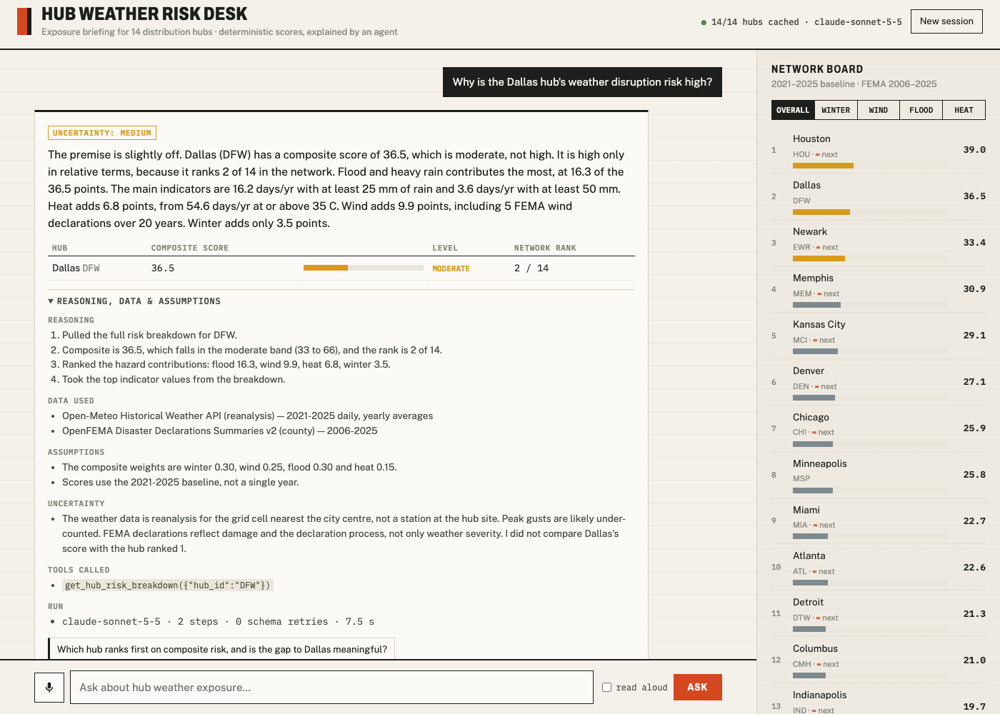

# Weather Risk Intelligence Agent

An AI agent that helps logistics analysts decide which US distribution hubs are most exposed to weather disruption and should get resilience investment.

**The numbers come from code; the agent explains them.** Public weather and disaster data are cached in SQLite and turned into deterministic, unit-tested hazard scores. Claude picks which scoring tool to call, then writes a structured, schema-validated explanation that cites the data, states its assumptions and flags uncertainty.

**Live demo:** https://weather-risk-agent-ae3s.onrender.com (an access code is required to chat; the access code is in the submission email. The free tier sleeps when idle, so the first load can take about a minute.)



- **Design and architecture:** [docs/ARCHITECTURE.md](docs/ARCHITECTURE.md)
- **One-page summary:** [docs/SUBMISSION.md](docs/SUBMISSION.md)
- **Plan, including the changes made while building:** [docs/PLAN.md](docs/PLAN.md)

## Quick start

Requirements: Python 3.12 and [uv](https://docs.astral.sh/uv/) (or pip), plus an Anthropic API key.

```bash
git clone https://github.com/contactTAM/weather-risk-agent.git && cd weather-risk-agent
uv sync                          # or: python3.12 -m venv .venv && .venv/bin/pip install -r requirements.txt
cp .env.example .env             # then set ANTHROPIC_API_KEY and LLM_MODEL (e.g. claude-sonnet-5-5)
uv run uvicorn app.api:app --port 8000
# open http://localhost:8000
```

No data download is needed. On first start the app restores `data/seed.sqlite.gz`, a 0.5 MB snapshot of the public data fetched on 2026-11-15. To fetch fresh data, run `uv run python -m app.data.refresh --force`; it takes a few minutes because Open-Meteo rate-limits free use.

`LLM_MODEL` is required and has no default in the code. The app refuses to start without it.

## Try these

- Which hubs in the Midwest are most exposed to winter disruption?
- Compare Miami and Houston in terms of hurricane and flood exposure.
- What percentage of days in Denver last year had snowfall?
- Why is the Dallas hub's weather disruption risk high?
- Follow-ups: "Rank the Midwest hubs by flood exposure." then "And what about Chicago?"
- Edge cases: "How exposed is our Seattle hub?" (not in the network) and "Best stock to buy?" (out of scope)

You can also click a hub on the network board to ask why it scores where it does. In Chrome, the mic button gives voice input, and "read aloud" speaks the answers.

## Commands

| What | Command |
|---|---|
| Run the API and UI | `uv run uvicorn app.api:app --port 8000` |
| Unit tests (50, no network, no LLM) | `uv run pytest` |
| Evaluation set (19 cases, live LLM, about $0.70–1.20 per run) | `uv run python -m evals.run` |
| Evals for some cases only, or against a running server | `uv run python -m evals.run --case dallas_why --api http://localhost:8000` |
| Evals against the protected deploy, paced under its limit of 20 chats per 10 minutes | `EVAL_ACCESS_CODE=... uv run python -m evals.run --api https://weather-risk-agent-ae3s.onrender.com --rate-limit 18` |
| Refresh public data | `uv run python -m app.data.refresh [--force] [--hub DEN]` |
| Ask one question from the CLI | `uv run python -m app.agent "Why is Dallas high?"` |
| Run the alert check once | `curl -X POST localhost:8000/alerts/check` |

## API

| Endpoint | Purpose |
|---|---|
| `POST /chat` `{session_id, message}` | Agent answer (schema below). The UI uses only this, `/scores` and `/health`. |
| `GET /scores?hazard=composite\|winter\|wind\|flood\|heat&region=&top_n=` | Deterministic ranking with drivers and close-call flags |
| `GET /hubs?region=` · `GET /hubs/{id}/breakdown` · `GET /hubs/{id}/alerts` | Hub list, full score breakdown, live NWS alerts |
| `POST /refresh` · `GET /refresh` | Background data refresh and its status |
| `POST /alerts/check?dry_run=` · `GET /alerts` · `POST /alerts/echo` | Risk-change alerts, alert log, local test webhook |
| `GET /health` | Data and model status |

A `/chat` response has these fields: `in_scope`, `answer`, `hubs[{hub_id, city, region, hazard, score, level, rank, of}]`, `focus_hazard`, `reasoning_steps[]`, `data_used[{source, period}]`, `assumptions[]`, `uncertainty{level, note}`, `follow_up_suggestions[]`, and `meta{model, steps, tools_called[], validation_retries, validation_errors[], grounding_warnings[], latency_ms, error}`. The code fills in the scores in `hubs`, never the LLM.

## Configuration (`.env`)

| Variable | Default | Meaning |
|---|---|---|
| `ANTHROPIC_API_KEY` | (required) | Anthropic key |
| `LLM_MODEL` | (required) | Model ID, e.g. `claude-sonnet-5-5` |
| `LLM_EFFORT` | `medium` | Model effort level |
| `LLM_FALLBACKS` | `default` | Server-side refusal fallback; `off` disables it |
| `DB_PATH` | `data/cache.sqlite` | SQLite file |
| `ACCESS_CODE` | (none) | When set, required on `/chat`, `/refresh` and `/alerts/check` (public deploys) |
| `CHAT_RATE_LIMIT` / `CHAT_RATE_WINDOW_S` | `20` / `600` | `/chat` requests per IP per window; `0` disables |
| `ALERT_WEBHOOK_URL` | (none) | Where alert JSON is POSTed (try `http://localhost:8000/alerts/echo`) |
| `ALERT_SCHEDULE_HOURS` | `6` | Alert job interval; `0` disables it |
| `ALERT_SCORE_DELTA` | `5` | Score change, in points, that triggers an alert (a level change always does) |
| `SCORING_CONFIG` | `config/scoring.yaml` | Alternative weights and anchors for what-if runs |
| `NWS_USER_AGENT` | `weather-risk-agent (demo)` | The NWS API requires a User-Agent |

## Deploy (Render, free tier)

The repo includes a `Dockerfile` and a `render.yaml` blueprint.

1. On render.com, choose **New → Blueprint**, select this repo, then **Apply**.
2. Enter the secrets it asks for: `ANTHROPIC_API_KEY`, `LLM_MODEL`, `ACCESS_CODE`, and optionally `ALERT_WEBHOOK_URL`.
3. Open the service URL. The UI asks for the access code on the first question.

Protection for a public URL: `/chat`, `/refresh` and `/alerts/check` require the `X-Access-Code` header when `ACCESS_CODE` is set, and `/chat` is rate-limited per visitor (`CHAT_RATE_LIMIT`, default 20 per 10 minutes). Read-only endpoints stay public. The free tier sleeps when idle, so open the URL about a minute before a demo. The disk is ephemeral; the data seed is restored on every start.

Locally with Docker: `docker build -t weather-risk-agent . && docker run -p 8000:8000 --env-file .env weather-risk-agent`

## Repository layout

```
app/
  api.py          FastAPI endpoints, serves the UI
  agent.py        Claude tool loop, structured output, validation retry, grounding checks, memory
  tools.py        6 typed tools (Pydantic args) over the scoring layer
  scoring.py      deterministic scoring: anchors, weights, ranks, breakdowns (pure functions)
  metrics.py      daily rows -> yearly indicator counts; weather statistics
  schemas.py      LLM answer schema, API response schema
  alerts.py       risk-change and NWS alerts, scheduler, webhook
  db.py config.py SQLite schema, settings, hub loader
  data/           open_meteo.py fema.py nws.py refresh.py seed.py http.py
config/scoring.yaml   weights, anchors, levels (documented)
data/hubs.yaml        14 fictional hubs in real cities (assumption)
static/               chat UI (HTML/CSS/JS, Web Speech API voice)
evals/                cases.yaml, run.py, sample_results.json
tests/                unit tests (scoring, metrics, fetchers with mocked HTTP, tools, agent with fake LLM, API, alerts)
docs/                 PLAN.md, ARCHITECTURE.md, SUBMISSION.md
```
